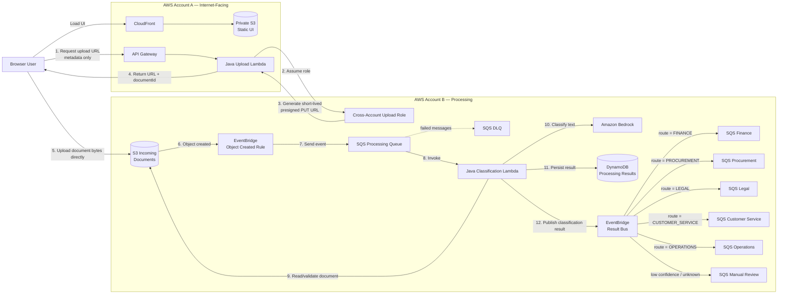

# Serverless AI Document Triage

> A hands-on AWS reference implementation for asynchronous document intake, AI-assisted classification, persistence, and workflow routing using a fully serverless multi-account architecture.

> **Status:** In progress. This repository is being built incrementally using simple vertical slices, starting with the happy path and adding reliability, security, observability, and operational concerns only when justified.

---

## Overview

This project demonstrates how a small document-intake platform can accept documents from a browser, upload them directly to Amazon S3, process them asynchronously, classify their content using Amazon Bedrock, persist the result, and route the outcome to a downstream workflow.

The implementation is intentionally designed for **low-to-bursty workloads** and favors managed AWS services, simple operational boundaries, and minimal application infrastructure.

The project is a **portfolio/reference implementation** using synthetic data and fictional business scenarios. It is not intended to represent a production system from any employer or customer.

---

## Architecture



### End-to-end flow

1. The browser requests an upload URL using file metadata and business context.
2. The Upload Lambda validates the request and creates a server-generated `documentId`.
3. The Lambda assumes a narrowly scoped role in the processing account.
4. A short-lived presigned S3 PUT URL is returned to the browser.
5. The browser uploads the document **directly to S3** in the processing account.
6. S3 publishes an object-created event through EventBridge.
7. EventBridge sends the event to the processing SQS queue.
8. The Classification Lambda reads the document, extracts text, and invokes Amazon Bedrock.
9. Application code validates the model response and applies deterministic routing rules.
10. The result is stored in DynamoDB.
11. A result event is published to a custom EventBridge bus.
12. EventBridge routes the result to a demonstration downstream SQS queue.

---

## Key Design Decisions

### Direct browser-to-S3 upload

Document bytes are not proxied through API Gateway or Lambda.

This keeps the control path and data path separate:

- **Control path:** Browser → API Gateway → Upload Lambda
- **Data path:** Browser → S3

This reduces unnecessary Lambda/API payload handling and keeps the upload path simple.

### Asynchronous processing

The processing path uses:

**S3 → EventBridge → SQS → Lambda**

SQS provides buffering between document arrival and classification, allowing the processing component to absorb bursts and later support retries and DLQ recovery.

### Multi-account boundary

The internet-facing components and document-processing components are separated into two AWS accounts.

The Upload Lambda does not receive broad access to the processing account. It assumes a narrowly scoped role that is intended only for creating documents under the incoming S3 prefix.

### Application-owned routing

Amazon Bedrock classifies the document and returns confidence-related information.

Application code owns:

- allowed classification values
- response validation
- confidence threshold
- workflow routing

The AI model does not directly choose AWS destinations.

---

## Supported Documents

Phase 1 supports:

| Type | Support |
|---|---|
| `.txt` | Yes |
| Text-based `.pdf` | Yes |
| Maximum file size | 5 MB |
| Scanned PDF | No |
| OCR/image extraction | No |
| DOC/DOCX | No |
| XLS/XLSX | No |
| PPT/PPTX | No |

Documents requiring OCR or richer document preparation are intentionally outside the first implementation.

---

## Classification Categories

The initial classification model uses:

- `INVOICE`
- `PURCHASE_ORDER`
- `CONTRACT`
- `CUSTOMER_COMPLAINT`
- `SERVICE_REQUEST`
- `UNKNOWN`

`UNKNOWN` and sufficiently low-confidence results are routed to `MANUAL_REVIEW`.

The final confidence threshold will be tuned using measured benchmark results rather than chosen arbitrarily.

---

## Business Context

The upload request can include a small amount of business metadata:

- **Business Journey**
- **Submission Purpose**
- **Business Reference** — optional

This context is stored with the document and can be used for processing, auditing, and future result lookup.

The user does **not** select the classification category.

---

## Technology Stack

| Area | Technology |
|---|---|
| Language | Java 25 |
| Build | Maven |
| Frontend | React + Vite |
| API | Amazon API Gateway |
| Compute | AWS Lambda |
| Object storage | Amazon S3 |
| Event routing | Amazon EventBridge |
| Messaging | Amazon SQS |
| AI classification | Amazon Bedrock |
| Persistence | Amazon DynamoDB |
| Observability | Amazon CloudWatch |
| Infrastructure as Code | AWS SAM / CloudFormation |
| Testing | JUnit 5 |

---

## Repository Structure

```text
serverless-ai-document-triage/
├── frontend/
├── upload-api/
├── classification-service/
├── infra/
│   ├── ife/
│   │   └── template.yaml
│   └── processing/
│       └── template.yaml
├── benchmark/
├── docs/
│   └── architecture/
├── pom.xml
└── README.md
```

The repository is intentionally kept small. Additional folders or abstractions should be added only when they solve a real implementation or documentation need.

---

## Reliability Approach

Reliability is introduced incrementally as the implementation evolves.

Relevant concerns include:

- duplicate SQS delivery
- idempotent processing
- retryable technical failures
- deterministic document rejection
- dead-letter queue handling
- partial success between persistence and event publication
- recovery from downstream publication failure

The project does not claim exactly-once delivery. Where required, stable identifiers and idempotent processing are preferred over attempting to eliminate all duplicate delivery.

---

## Security Approach

The architecture is designed around:

- least-privilege IAM
- narrowly scoped cross-account role assumption
- private S3 buckets
- short-lived presigned URLs
- encryption in transit
- no document contents in application logs
- minimal exposure of sensitive metadata
- separation of internet-facing and processing workloads

Authentication, WAF, malware scanning, and other controls are intentionally outside the initial scope unless later requirements justify them.

---

## Observability

The target implementation will use CloudWatch for:

- structured application logs
- processing success/failure metrics
- Lambda errors and throttles
- SQS backlog monitoring
- DLQ alarms
- classification latency
- low-confidence/manual-review rates

`documentId` is the primary processing correlation identifier.

Raw document content and full AI prompts/responses should not be written to logs.

---

## Benchmark

A small benchmark will use approximately **20 synthetic labelled documents**.

Measured results will include:

- classification accuracy
- classification latency
- failures
- low-confidence rate
- approximate AI classification cost

Only actual measured values will be documented.

---

## Workload Assumptions

These are design assumptions rather than measured production claims:

- approximately 100 documents per day
- occasional bursts of approximately 100 documents over several minutes
- maximum document size of 5 MB
- eventual consistency is acceptable
- downstream SQS queues represent demonstration integration boundaries

These assumptions intentionally favor a serverless architecture over continuously running worker infrastructure.

---

## Infrastructure

The system uses separate infrastructure stacks for the two AWS accounts:

```text
infra/
├── ife/
│   └── template.yaml
└── processing/
    └── template.yaml
```

The processing stack is expected to be deployed first so that Account A can receive the required processing-account configuration.

---

## Running Locally

The project is being implemented incrementally. Commands will be updated as each slice becomes usable.

### Java

```bash
./mvnw clean test
```

Windows:

```powershell
.\mvnw.cmd clean test
```

### Frontend

```bash
cd frontend
npm install
npm run dev
```

AWS deployment instructions will be added once the corresponding infrastructure slices are implemented.

---

## Development Approach

The project is deliberately built in vertical slices:

1. Direct document upload
2. S3 → EventBridge → SQS → Lambda event pipeline
3. TXT/PDF document reading
4. Bedrock classification
5. DynamoDB persistence
6. Reliability and idempotency
7. Result event routing
8. Security hardening
9. Observability
10. Benchmark and integration testing
11. Deployment and CI/CD

Each slice starts with the simplest working flow. Validation, failure handling, resilience, and additional abstractions are introduced only when the implementation demonstrates a real need for them.

---

## Non-Goals

The first version intentionally excludes:

- user authentication / Cognito
- AWS WAF
- malware scanning
- quarantine workflows
- OCR / Textract
- Office document processing
- Step Functions
- Spring Boot
- ECS / Kubernetes
- Kafka / MSK
- RDS
- OpenSearch / vector databases
- RAG
- model fine-tuning
- real Finance/Legal/Operations applications

These may be explored separately if future requirements justify them.

---

## Limitations

This is a portfolio/reference implementation, not a production-ready enterprise platform.

Known limitations include:

- only TXT and text-based PDF documents are supported
- downstream systems are represented by queues rather than real applications
- authentication and advanced edge-security controls are outside the initial scope
- benchmark scale is intentionally small
- operational and disaster-recovery controls are limited to what is useful for demonstrating the architecture

---

## License

Add the license appropriate for your repository before publishing.
